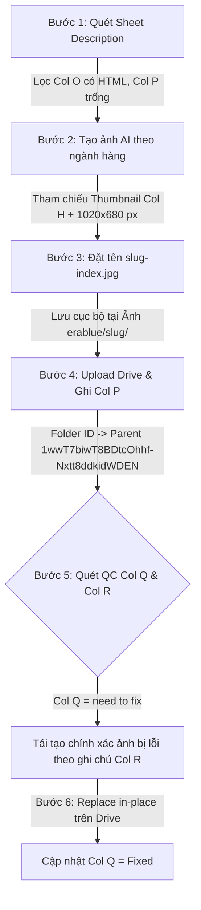

# Erablue Image Pipeline Automation (Đóng gói Quy trình 6 Bước)

Tài liệu đặc tả và hướng dẫn vận hành hệ thống tự động hóa ảnh sản phẩm hoàn chỉnh cho **Erablue Indonesia**, kết nối trực tiếp giữa **Google Sheet (tab Description)**, **AI Generation Engine (OpenRouter - gpt-image-2.5-sunburst)** và **Google Drive Cloud Storage**.

---

## 📌 Tổng Quan Quy Trình 6 Bước Chuẩn



---

## 🛠️ Chi Tiết Kỹ Thuật Từng Bước

### Bước 1: Quét và Lọc Dữ Liệu Sheet
- **Google Sheet ID:** `1dp3cY7CAs-OGbc4jCyUC3oNmkNA5LB1AkTINKl_n0BU` (Tab: `Description`).
- **Điều kiện kích hoạt:** Hàng có nội dung bài viết HTML tại **Cột O** (`Description HTML`) nhưng **Cột P** (`File images`) còn trống.
- **Dữ liệu trích xuất:** Tên sản phẩm (Cột B), URL sản phẩm tạo Slug (Cột C), Thumbnail ảnh gốc (Cột H), Nội dung HTML phân tách theo thẻ `<h2>`/`<h3>` (Cột O).

### Bước 2: Tạo Ảnh Chuẩn E-Commerce Erablue
- **AI Model:** `openai/gpt-image-2.5-sunburst` qua OpenRouter API.
- **Prompt Master:** Ánh xạ từ kho prompt 461 danh mục (`Era_Promt tạo ảnh - Prompt Ảnh.csv`).
- **Ảnh tham chiếu (Vision Input):** Luôn truyền ảnh Thumbnail từ Cột H (đã tải và convert chuẩn PNG base64) để model AI sao chép chính xác 100% hình dáng sản phẩm (màu sắc, nắp mở, nút bấm, vòi nước, bảng điều khiển).
- **Quy chuẩn Ngôn ngữ:** **100% Bahasa Indonesia**. Tuyệt đối không để sót tiếng Việt hoặc tiếng Anh máy dịch thô.
- **Typography & Bố cục:** 3 tầng chữ tối đa (Nhãn công nghệ -> Tiêu đề in hoa -> 1-2 dòng lợi ích ngắn gọn). Phông Sans-serif hình học hiện đại, tương phản cao, không chồng chéo chữ.
- **Quy chuẩn Kích thước & Định dạng:** Kích thước canvas `1020 x 680 px` (tỷ lệ 3:2), định dạng `JPG`, dung lượng nén tối ưu `< 500 KB`.

### Bước 3: Đặt Tên File & Lưu Trữ Cục Bộ
- **Cấu trúc đặt tên:** `<slug-sản-phẩm>-<thứ_tự_h2>.jpg`
  - Ví dụ: `ac-split-daikin-inverter-075-pk-ftkh20yv14-1.jpg`
- **Thư mục lưu trữ:** `/Users/trannguyenmy/Desktop/Antigravity/Ảnh erablue/<slug-sản-phẩm>/`

### Bước 4: Đồng Bộ Google Drive & Ghi Link Cột P
- **Thư mục mẹ (Parent Drive):** `1wwT7biwT8BDtcOhhf-Nxtt8ddkidWDEN`
- **Thao tác CLI:** Sử dụng `@googleworkspace/cli drive files create` tạo subfolder mang tên `<slug-sản-phẩm>`.
- **Upload:** Tải toàn bộ ảnh trong thư mục cục bộ lên subfolder trên Drive.
- **Ghi nhận Sheet:** Cập nhật đường link `https://drive.google.com/drive/folders/<folder_id>` vào **Cột P** của dòng tương ứng.

### Bước 5: Kiểm Tra Feedback (Quality Control)
- **Quét điều kiện:** Tìm các dòng có **Cột Q** mang giá trị `need to fix` (hoặc có ghi chú sửa ảnh ở Cột R).
- **Phân tích ghi chú Cột R (AI / Regex Parser):**
  - Nhận diện số thứ tự Jpeg cần sửa: ví dụ `Jpeg 1`, `Jpeg No.8`, `gbr 6`.
  - Nhận diện lỗi toàn bộ ảnh: ghi chú chứa `every design have a different product picture` -> Đánh dấu sửa toàn bộ các ảnh để đồng bộ đúng ảnh gốc Thumbnail Cột H.
  - Bóc tách nội dung sửa đổi: cụm từ cần thay thế (ví dụ: đổi từ `"LEBIH BANYAK HAL..."` thành `"MAKSIMALKAN..."`).

### Bước 6: Sửa Ảnh & Upload Thay Thế (Replace) Trên Drive
- **Tái tạo ảnh có chọn lọc:** Chỉ tạo lại những ảnh có tên trong danh sách cần sửa của Bước 5. Không tạo lại các ảnh đã đạt chuẩn.
- **Upload thay thế in-place:** Sử dụng lệnh `drive files update --params '{"fileId": "<file_id>"}' --upload <filename>`:
  - Thay thế file cũ trên Drive bằng file mới tạo.
  - **Giữ nguyên File ID**, không làm đổi link chia sẻ của khách hàng.
  - **Giữ nguyên 100% các file ảnh khác** trong thư mục Drive của sản phẩm đó.
- **Đóng vòng lặp QC:** Cập nhật giá trị **Cột Q** thành `Fixed`.

---

## 💻 Hướng Dẫn Sử Dụng Command-Line (CLI)

Script điều phối tập trung được đặt tại:
`scripts/erablue_image_pipeline.py`

### 1. Kiểm tra trạng thái tổng quan toàn bộ Sheet
```bash
python3 scripts/erablue_image_pipeline.py status
```
*Hiển thị số lượng sản phẩm đã hoàn thành, số sản phẩm chờ tạo ảnh mới (Bước 1), và số sản phẩm reviewer đánh dấu cần sửa (Bước 5).*

### 2. Tạo ảnh mới cho các sản phẩm chưa có ảnh (Bước 1 - 4)
```bash
# Tạo cho toàn bộ sản phẩm chờ:
python3 scripts/erablue_image_pipeline.py create

# Giới hạn thử nghiệm 5 sản phẩm đầu tiên:
python3 scripts/erablue_image_pipeline.py create --limit 5
```

### 3. Quét danh sách feedback chi tiết từ Reviewer (Bước 5)
```bash
python3 scripts/erablue_image_pipeline.py check-qc
```
*In ra chi tiết từng sản phẩm cần fix, link folder Drive, ghi chú gốc, và danh sách Jpeg cùng yêu cầu cụ thể đã được phân tích tự động.*

### 4. Sửa ảnh và Replace trực tiếp trên Google Drive (Bước 5 - 6)
```bash
# Tự động sửa và replace toàn bộ các sản phẩm bị 'need to fix':
python3 erablue_image_pipeline_package/pipeline.py fix-qc

# Chỉ định sửa riêng 1 dòng cụ thể trên Google Sheet (ví dụ Row 25):
python3 erablue_image_pipeline_package/pipeline.py fix-qc --row 25
```

### 5. Đăng bài viết HTML & ảnh tương ứng từng Heading lên PIM
```bash
# Đăng bài viết và ảnh Gallery cho 1 sản phẩm (ví dụ dòng 26 trên Sheet):
python3 erablue_image_pipeline_package/pipeline.py upload-pim --row 26

# Đăng bài hàng loạt theo khoảng dòng (ví dụ từ dòng 26 đến 51):
python3 erablue_image_pipeline_package/pipeline.py upload-pim --rows 26-51
```

---

## ⚠️ Bộ Luật Bất Biến (Core Inviolable Rules)

1. **Tuyệt đối không đổi File ID hoặc xóa ảnh cũ không liên quan:** Khi chạy Bước 6, script chỉ cập nhật nội dung file (update) đối với đúng Jpeg được reviewer chỉ ra. Toàn bộ các ảnh đạt chuẩn khác trong Drive phải được giữ nguyên vẹn.
2. **Ngôn ngữ chuẩn 100% Bahasa Indonesia:** Mọi tiêu đề, nhãn công nghệ, mô tả trên banner phải là tiếng Indonesia tự nhiên của người bản địa. Cấm dùng tiếng Việt hoặc tiếng Anh thô.
3. **Toàn vẹn ngoại hình sản phẩm từ Thumbnail:** Nếu reviewer ghi nhận `every design have a different product picture`, toàn bộ ảnh phải được kiểm tra lại với Thumbnail Cột H để đảm bảo từ hình khối, màu sắc đến các chi tiết vật lý của thiết bị là đồng nhất qua tất cả các slide.
4. **Chuẩn kích thước 1020x680 px và dung lượng dưới 500KB:** Đảm bảo tốc độ tải trang nhanh và hiển thị mượt mà trên hệ thống CMS Erablue.
